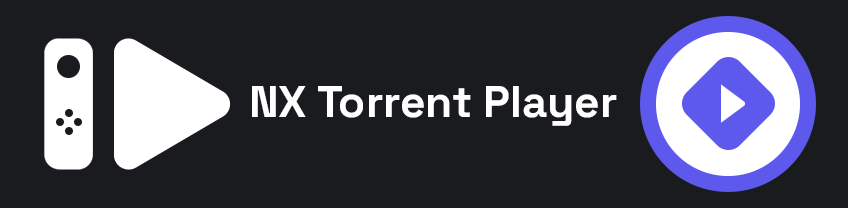
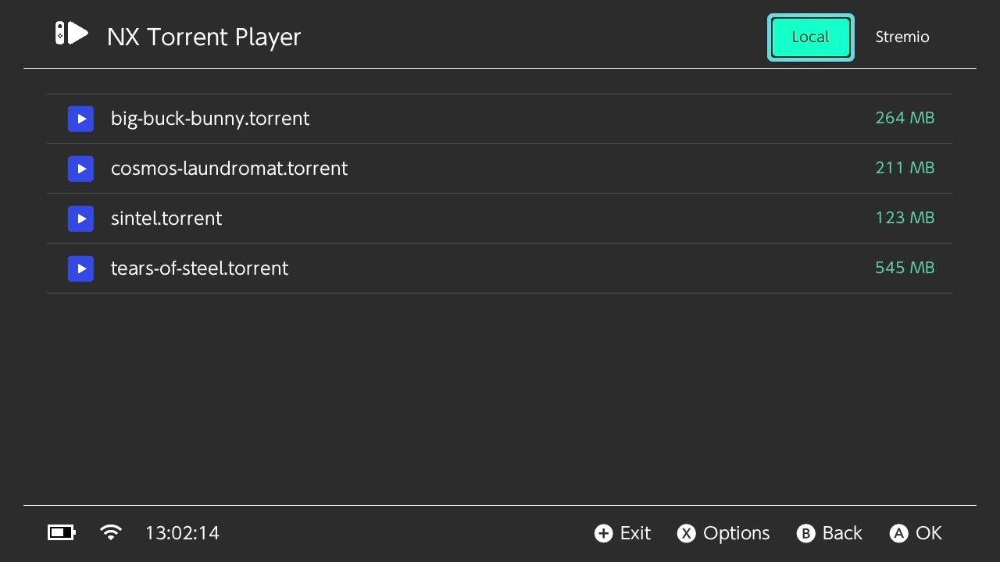
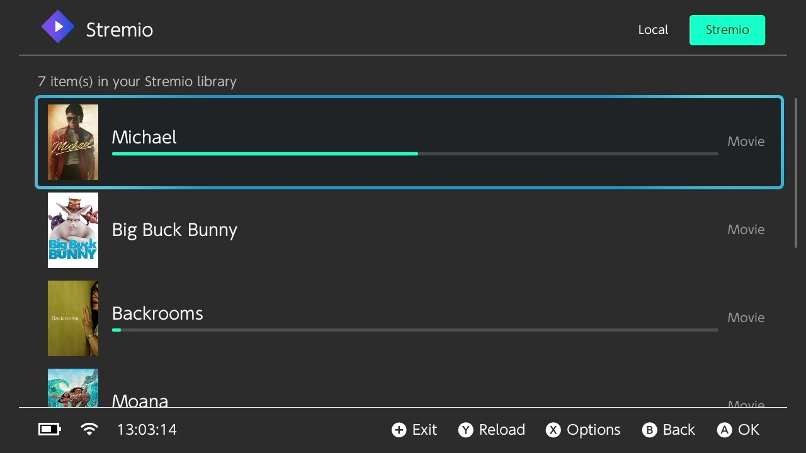
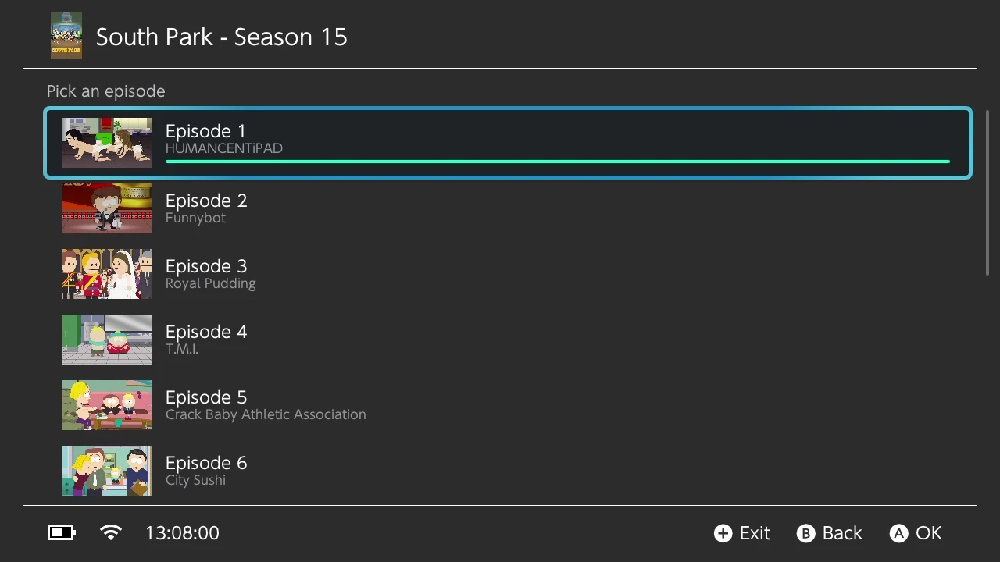
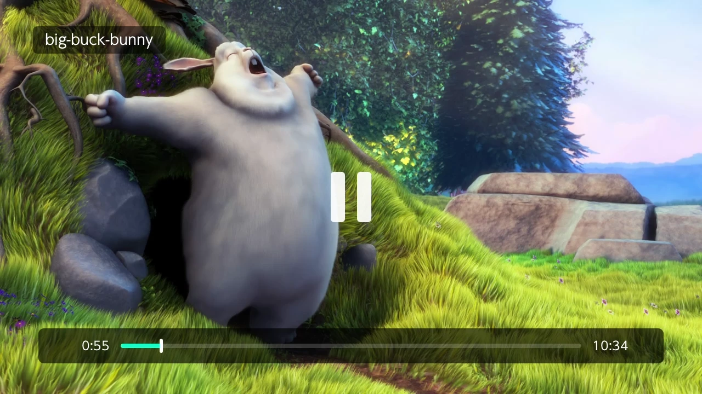

# NX Torrent Player

**NX Torrent Player: Stremio on Nintendo Switch and Switch 2**

A homebrew video player with a BitTorrent engine built in. It does not download
a file and then play it: it downloads the pieces it is about to need, in order,
and starts playing after a few seconds of buffer. Sign in to a Stremio account
and your library, addons and sources are included too.

> Requires a Switch running custom firmware (Atmosphère), or a Switch 2 running
> [kaiHEN](https://github.com/ouncebrew/kaihen).

---

## Features

- **Streams torrents** — playback starts on the first pieces; the engine keeps
  downloading ahead of the playhead, and re-centres on it when you seek.
- **Stremio integration** — sign in, browse your library, drill down through
  seasons → episodes → addons → sources, artwork and all.
- **Local torrents & magnets** — drop `.torrent` files on the SD card, or add
  magnet links (a `magnet.txt` file, or the on-screen keyboard). A magnet's name
  and file list are resolved and cached so you can pick which video to stream.
- **Player** — audio/subtitle track menu, analog scrubbing (either stick), touch
  controls, a control lock (Y), and auto-resume where you left off.
- **borealis** UI: Horizon look, controller-first, touch works too.
- **Switch 2** — a native build (libounce + OunceVK), not the Switch 1 binary.

## Screenshots

<table>
  <tr>
    <td></td>
    <td></td>
  </tr>
  <tr>
    <td></td>
    <td></td>
  </tr>
</table>

## Install

1. Download the `.nro` for your console from the [releases](../../releases), or
   build it (below):
   - **Switch**: `NX-torrent-player.nro`
   - **Switch 2**: `NX2-torrent-player.nro`

   They are not interchangeable: each one only runs on its own console.
2. Put it on your SD card in `/switch/NX-torrent-player/` (create the folder).
3. Launch it from the **Homebrew Menu** (on Switch 2, the hbmenu kaiHEN opens).

Updating is done from inside the app (Options → Check on startup is on by
default); it downloads the `.nro` for the console it runs on, replaces itself
and restarts.

## Usage

### Local torrents & magnets

Drop `.torrent` files into `sdmc:/switch/NX-torrent-player/torrents/`
(sub-folders are scanned too) and they appear in the **Local** tab with the
torrent's total size.

Magnet links show up in the same list. Add them either by editing
`torrents/magnet.txt` (one magnet link or bare info-hash per line) or with the
**Add magnet** button at the top of the tab (on-screen keyboard). A magnet's
name and file list are fetched in the background — a spinner shows which one is
resolving — and cached, so next time it lists and opens instantly.

Press **Y** on an entry to remove it (a magnet is dropped from the list; a
`.torrent` file is deleted from the SD card). When a torrent — local or magnet —
holds several videos, you get to pick which one; if it has no video, it says so.


### Stremio

In the **Stremio** tab, sign in with your email and password, or pick **Sign in
with a QR code** and scan it with a phone already signed in to Stremio (or type
the 4-character code at link.stremio.com) — no password on the on-screen
keyboard. The session is kept and survives a restart (sign out from Options).

Pick a title → for a show, a season, then an episode → an addon → a source.
Sources are whatever your addons return; only BitTorrent ones can be 
played, and the ones that can't say so up front. 4K sources
are hidden by default — the Switch outputs 1080p docked, so they cost bandwidth
for pixels it cannot show. Turn that off in Options.

## Building

devkitPro is not needed locally — build in the official Docker image, keeping
the build tree in a named volume so it survives between runs:

```sh
# configure once, on a fresh volume
docker run --rm -v st_build:/build -v "$PWD":/project -w /build \
    devkitpro/devkita64:latest sh -c "cmake /project"

# build
docker run --rm -v st_build:/build -v "$PWD":/project -w /build \
    devkitpro/devkita64:latest \
    sh -c "cmake --build . --target NX-torrent-player.nro"

# copy the .nro out of the volume
docker run --rm -v st_build:/build -v "$PWD":/project \
    devkitpro/devkita64:latest sh -c "cp /build/NX-torrent-player.nro /project/"
```

On Windows/Git Bash, prefix each command with `MSYS_NO_PATHCONV=1`, or the
container paths get rewritten. Adding or removing a source file needs a `cmake .`
pass first, since the sources are globbed.

Dependencies come from devkitPro's portlibs (`switch-mpv`, `switch-curl`,
`switch-libwebp`, `switch-mbedtls`…) and are already in the image. borealis is
vendored under `library/`.

### Switch 2

The Switch 2 build uses ouncebrew's [devkit](https://github.com/ouncebrew/ounce-devkit)
(libounce in place of libnx, OunceVK for EGL/OpenGL) and runs from the
hbmenu that [kaiHEN](https://github.com/ouncebrew/kaihen) launches. It is a
separate `.nro`: a Switch 1 build does not run on Switch 2, and vice versa.
Build the devkit's image once, then use a second volume:

```sh
# the devkit image (clone with LF line endings, or install.sh fails in the container)
git clone -c core.autocrlf=false https://github.com/ouncebrew/ounce-devkit
docker build -t ounce-devkit ounce-devkit

# configure once, then build
docker run --rm -v st_build2:/build -v "$PWD":/project -w /build ounce-devkit \
    sh -c "cmake /project -DPLATFORM_SWITCH2=ON -DCMAKE_BUILD_TYPE=Release"
docker run --rm -v st_build2:/build -v "$PWD":/project -w /build ounce-devkit \
    sh -c "cmake --build . --target NX-torrent-player.nro && \
           cp NX2-torrent-player.nro /project/"
```

## Credits

- [borealis](https://github.com/xfangfang/borealis) — UI framework (vendored,
  with one local patch: see `library/borealis/VENDORED.md`)
- [mpv](https://mpv.io/) — playback
- [libutp](https://github.com/bittorrent/libutp) — uTP transport
- [Stremio](https://www.stremio.com/) — account, library and addon protocol. This
  project is not affiliated with Stremio.
- [curl](https://curl.se/docs/caextract.html) — the CA bundle in
  `assets/cacert.pem`, Mozilla's root store, which is what certificates get
  checked against on a console that mounts none
- devkitPro / libnx — toolchain
- [ouncebrew](https://github.com/ouncebrew) — the Switch 2 devkit (libounce,
  OunceVK) and kaiHEN
